<p align="center">
  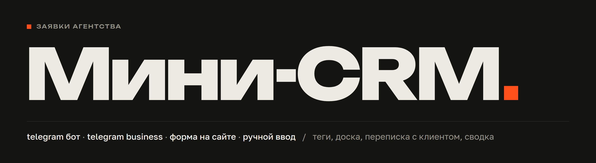
</p>

<p align="center">
  <a href="https://litvinskiy-dev.ru">живая crm</a> &nbsp;·&nbsp;
  <a href="https://t.me/poiskahd_bot">бот в telegram</a> &nbsp;·&nbsp;
  <a href="https://litvinskiy-dev.ru/form">форма заявки</a> &nbsp;·&nbsp;
  <a href="#как-выглядит">скриншоты</a> &nbsp;·&nbsp;
  <a href="#запуск">запуск</a> &nbsp;·&nbsp;
  <a href="#на-сервер">на сервер</a>
</p>

<div align="center">

| 4 | 86 | 0 | 2 |
|:---:|:---:|:---:|:---:|
| источника лидов | автотестов | внешних зависимостей | темы интерфейса |

</div>

сюда собираются заявки агентства из telegram бота, из обычного telegram аккаунта, с формы на сайте и руками, у каждого лида есть теги и по тегу список фильтруется одним кликом, а дальше обычная работа с заявкой: статус, ответственный, срок, сумма, переписка с клиентом прямо из карточки, доска и сводка, всё лежит в sqlite, сервер на голом питоне без единой зависимости, фронт это один html, один css и несколько js без сборки, шрифт unbounded.

сделано как тестовое задание вайбкодера, за три дня от идеи до работающей вещи, поэтому набросок продукта и разбор лежат рядом в `docs/`, а здесь ровно то, что просит задание: ссылка, проблема, контур, что в mvp, как проходятся обязательные пункты и как это проверить.

> [!IMPORTANT]
> проект для проверки уже выложен на сервере и открывается по https, вход по паролю, пароль в сообщении вместе со ссылкой.
>
> на этом же сервере работает telegram бот @poiskahd_bot. хостинг закрывает telegram напрямую, поэтому бот ходит в него через платный http прокси, оплаченный до 11 октября 2026, 19:36. после этого бот на сервере замолчит, а сайт, форма и ручные лиды продолжат работать.
>
> на сервере стоит и другой проект, mini-crm живёт рядом отдельным сервисом со своим портом, доменом и базой и ничего чужого не трогает. в базе лежат 46 демо лидов с тегом «Демо», чтобы доска и сводка не были пустыми, их можно убрать за пару кликов.

| что | где |
|:---|:---|
| crm | https://litvinskiy-dev.ru |
| бот в telegram | https://t.me/poiskahd_bot |
| форма заявки для сайта | https://litvinskiy-dev.ru/form |

## как выглядит

скриншоты сняты с локальной копии на тех же демо данных, что лежат на сервере, в кадре с карточкой добавлен пример переписки, а зелёный индикатор бота в левом нижнем углу означает эмулятор telegram, на сервере он показывает настоящего бота.

<p align="center">
  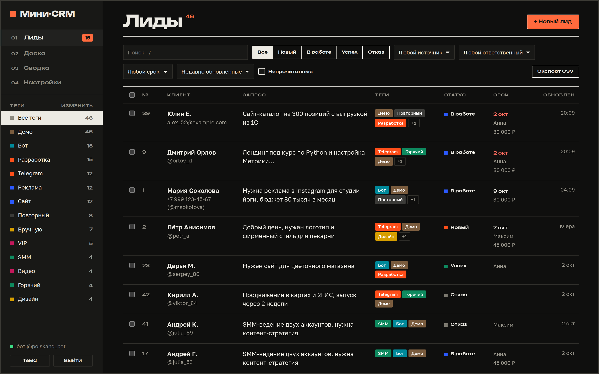<br>
  <sub>список лидов, слева теги со счётчиками, дальше статус, срок, ответственный и сумма, непрочитанные подсвечены</sub>
</p>

<table>
  <tr>
    <td width="50%">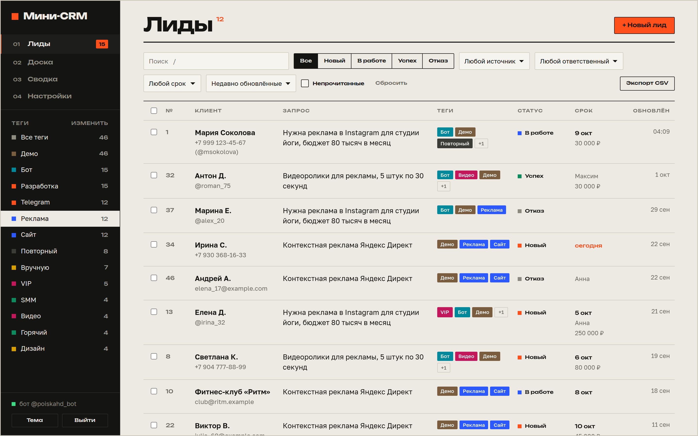<br><sub>фильтр по тегу, клик по тегу слева оставляет только его лидов</sub></td>
    <td width="50%">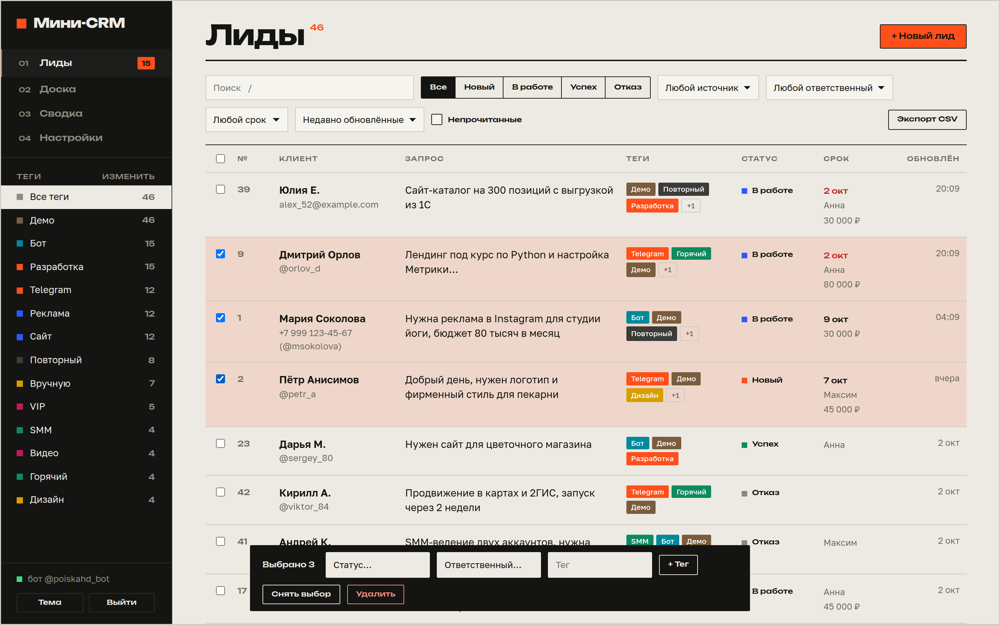<br><sub>массовые действия, несколько лидов сразу в другой статус, к ответственному или с новым тегом</sub></td>
  </tr>
</table>

<p align="center">
  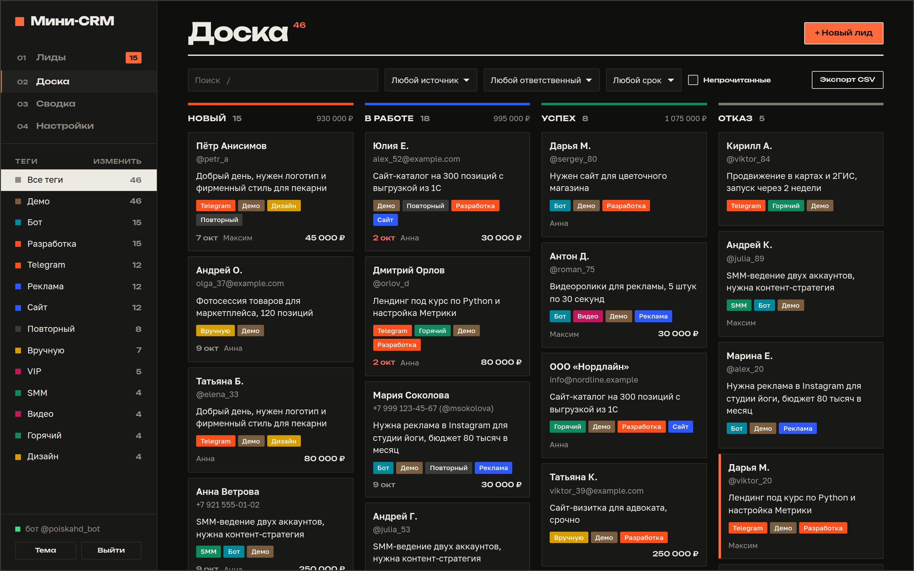<br>
  <sub>доска, статусы колонками, сумма по каждой, карточки перетаскиваются мышью</sub>
</p>

<p align="center">
  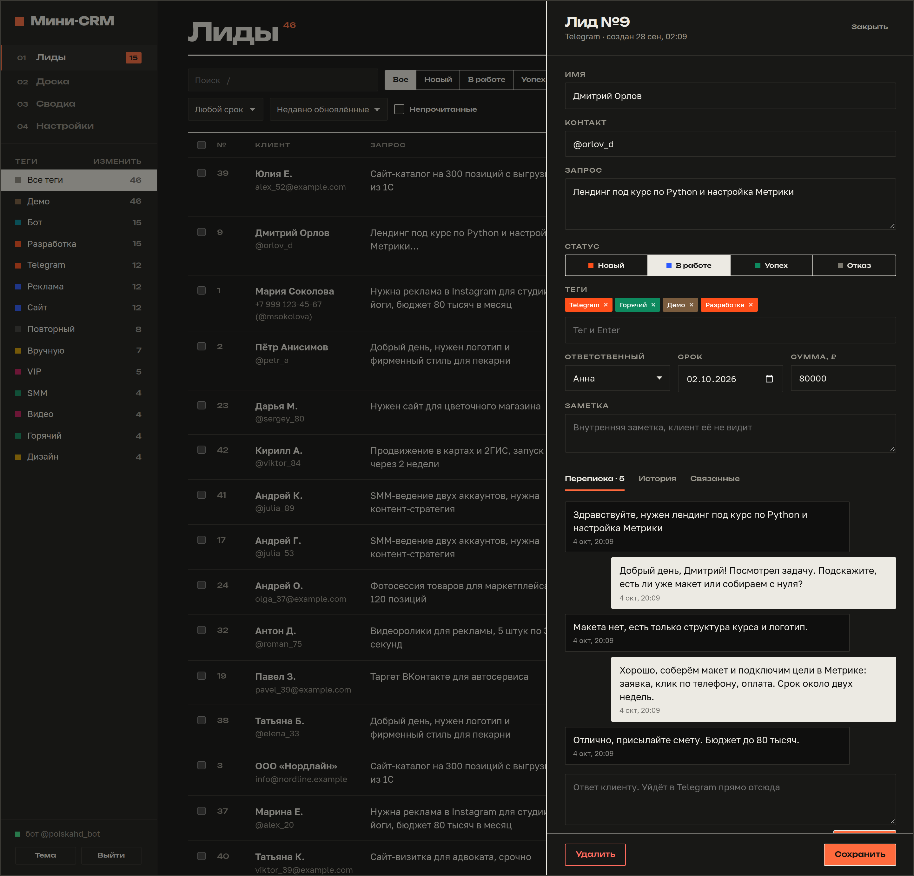<br>
  <sub>карточка лида: поля, статус, теги, ответственный, срок, сумма и переписка с ответом клиенту прямо из crm</sub>
</p>

<p align="center">
  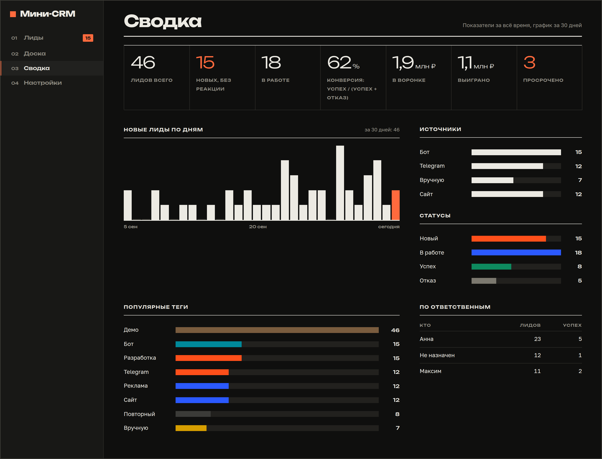<br>
  <sub>сводка: лиды по дням, источники, статусы, конверсия, воронка в рублях и нагрузка по менеджерам</sub>
</p>

<table>
  <tr>
    <td width="50%">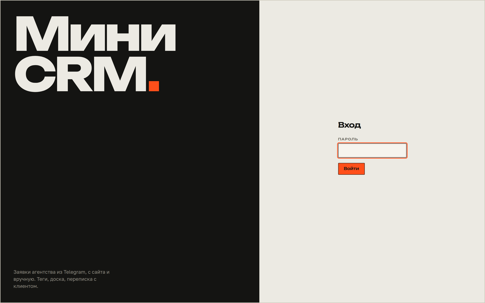<br><sub>вход по паролю</sub></td>
    <td width="50%">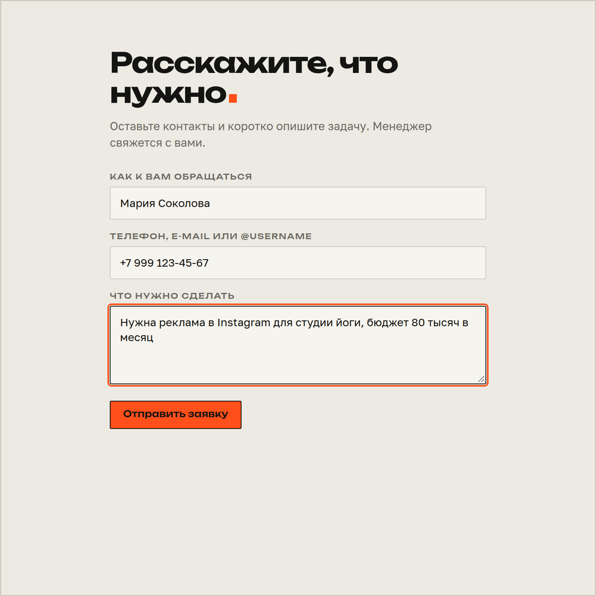<br><sub>публичная форма для сайта, метка <code>?ref=instagram</code> становится тегом лида</sub></td>
  </tr>
</table>

<p align="center">
  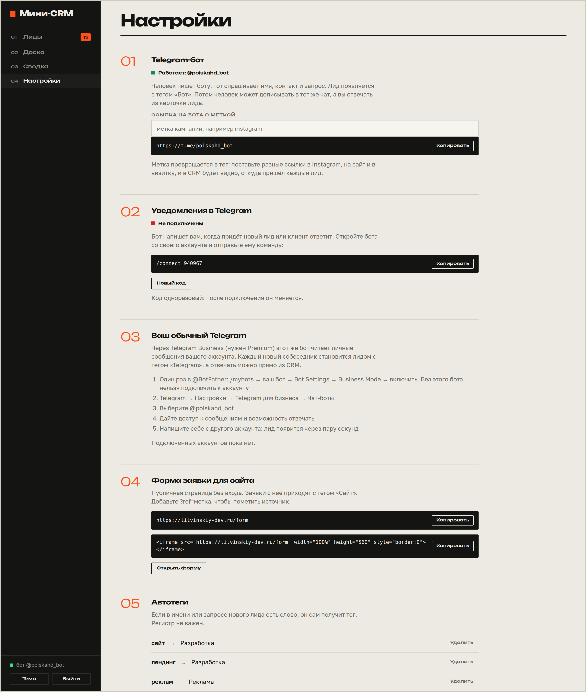<br>
  <sub>настройки: ссылка на бота с меткой, уведомления, подключение обычного telegram, форма для сайта, автотеги, команда, теги, csv</sub>
</p>

<p align="center">
  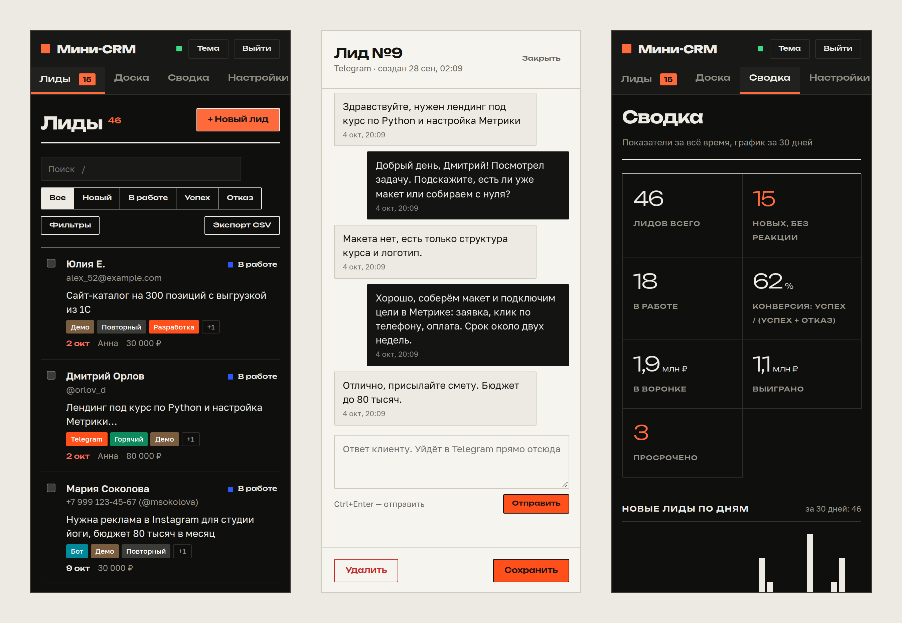<br>
  <sub>телефон: интерфейс перестраивается под узкий экран, таблица становится карточками, плитки сводки идут в две колонки</sub>
</p>

## проблема и для кого

заявки в небольшое агентство приходят сразу в трёх местах, клиенты пишут боту, пишут менеджеру в личку и оставляют форму на сайте, и всё это живёт в переписках, где лид теряется между «ответил позже» и «забыл записать», единого списка нет, непонятно кто новый и кто уже в работе, а собрать всех, кому нужен сайт, нельзя вообще.

делал для владельца или менеджера агентства от одного до пяти человек, у которого главный канал продаж telegram, битрикс и amocrm ему тяжелы, настройка там занимает больше времени, чем даёт пользы.

## как это работает

один процесс питона, внутри http сервер с api и интерфейсом и поток, который опрашивает telegram через long polling, поэтому ни домен, ни сертификат боту не нужны, он запускается где угодно, где есть выход в telegram.

<p align="center">
  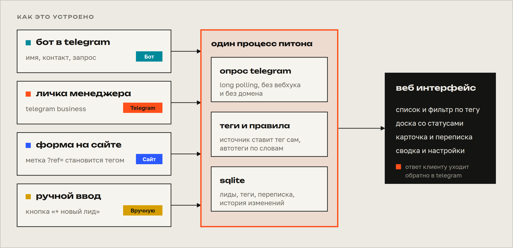
</p>

каждый источник сам ставит лиду свой тег: «Бот», «Telegram», «Сайт» или «Вручную», а менеджер добавляет свои, поэтому фильтр по тегу работает с первой минуты и без ручной разметки.

диалог бота хранится в базе и лид создаётся только после последнего ответа, так что бросившие на втором вопросе не засоряют список, а перезапуск сервера не обрывает разговор, брошенный диалог через сутки начинается заново.

после заявки сообщения человека идут в её переписку, а не плодят новые лиды, ответить можно прямо из карточки, и ответ придёт клиенту в telegram, новая заявка начинается командой `/new`, а ссылка вида `t.me/бот?start=instagram` превращает метку в тег, чтобы было видно, откуда пришёл лид.

## обязательные пункты задания

1. **заявки из бота.** человек пишет боту, бот спрашивает имя, контакт и запрос и после последнего ответа заявка сама появляется в crm с тегом «Бот», полный путь от сообщения до лида с тегом прогоняется тестом `tests/test_tz.py`
2. **подключение обычного telegram.** сделано через telegram business: менеджер подключает бота к своему аккаунту, и каждое входящее личное сообщение становится лидом с тегом «Telegram», следующие сообщения того же человека дописываются в этот же лид, а сообщения самого владельца лидом не становятся, нужен telegram premium у владельца аккаунта и включённый business mode у бота в `@BotFather`, как это делается, описано ниже в разделе про подключение
3. **ручное добавление.** кнопка «+ новый лид», тег «Вручную», лида можно открыть и отредактировать, а ещё загрузить пачкой из csv
4. **теги.** лиду можно присвоить любые теги в карточке, слева виден список тегов со счётчиками, клик по тегу оставляет в списке только его лидов, есть массовое добавление тега, автотеги по ключевым словам, переименование, перекраска и слияние

если premium у менеджера нет, второй путь для пункта 2 это юзербот на telethon, который принимает номер, код и пароль 2fa и слушает личные чаты, я его не делал и описал в `docs/01-product-sketch.md`, обработчик лидов от источника не зависит, так что это новый слушатель, а не переделка.

## что входит в mvp и что за скобками

обязательное ядро это четыре пункта выше, и сверх него то, без чего crm остаётся просто списком: ответы клиенту из карточки, статусы и доска с перетаскиванием, ответственный, срок и сумма, история изменений по лиду, связанные заявки одного человека, публичная форма для сайта, уведомления менеджеру в telegram, импорт и экспорт csv, сводка с графиком по дням, конверсией и воронкой, светлая и тёмная тема, поиск и горячие клавиши.

сознательно оставлено за скобками: роли и отдельные логины менеджеров, воронка с настраиваемыми этапами, автоматическое объединение дублей, другие мессенджеры, шаблоны ответов и напоминания по сроку в telegram.

## запуск

нужен только python 3.11+, ничего ставить не надо:

```bash
BOT_TOKEN=<токен от @BotFather> CRM_PASSWORD=<пароль> python3 server.py
```

открываешь `http://127.0.0.1:8080`, без `BOT_TOKEN` crm работает, но бот выключен, ручные лиды, форма и теги при этом доступны.

| переменная | зачем |
|:---|:---|
| `BOT_TOKEN` | токен бота от `@BotFather`, без него бот выключен |
| `CRM_PASSWORD` | пароль входа, по умолчанию `admin`, с ним сервер слушает только localhost и откажется выходить в сеть |
| `CRM_HOST`, `CRM_PORT` | адрес и порт сервера |
| `CRM_DB` | путь к базе sqlite |
| `CRM_SECRET` | ключ подписи сессий, если не задан, берётся из базы |
| `CRM_TRUST_PROXY` | `1`, если стоишь за прокси не на localhost, за локальным caddy или nginx адрес клиента берётся из `X-Forwarded-For` сам |
| `TG_API_BASE` | адрес api telegram, нужен только за прокси или в тестах |
| `HTTPS_PROXY` | http прокси до telegram, python берёт его из окружения без правок кода |

чтобы не писать переменные каждый раз, положи их в `.env` рядом с `server.py` (пример в `.env.example`, сам файл в `.gitignore`) и запускай так:

```bash
bash run.sh
```

чтобы посмотреть интерфейс с данными, а не пустым:

```bash
CRM_DB=/tmp/demo.db python3 seed_demo.py && CRM_DB=/tmp/demo.db python3 server.py
```

это зальёт 46 лидов за тридцать дней с тегами, ответственными, сроками и суммами, все они помечены тегом «Демо» и без telegram идентификаторов, так что ответить им из crm нельзя, а убрать их можно разом: фильтр по тегу, выбрать всех, удалить.

## подключение telegram

**бот.** создаёшь в `@BotFather` командой `/newbot`, токен кладёшь в `BOT_TOKEN`, после запуска в левом нижнем углу интерфейса загорится «бот @имя», а в настройках появится ссылка на бота, которую можно собрать с меткой кампании.

**уведомления менеджеру.** в настройках, раздел «уведомления в telegram», там одноразовый код, отправляешь боту `/connect КОД` со своего аккаунта, и дальше он пишет тебе про каждый новый лид и каждое сообщение клиента.

**обычный telegram.** один раз в `@BotFather`: `/mybots`, твой бот, bot settings, business mode, включить, потом в самом telegram: настройки, telegram для бизнеса, чат боты, выбрать бота и разрешить читать сообщения и отвечать, напиши себе с другого аккаунта, и через пару секунд лид появится в списке.

## проверить за пять минут

1. открыть crm по ссылке и войти по паролю
2. написать боту https://t.me/poiskahd_bot и ответить на три вопроса, через несколько секунд лид появится сам, с тегом «Бот», и на странице всплывёт «новый лид»
3. открыть этого лида, добавить тег, например «горячий», и сохранить
4. слева кликнуть по тегу «горячий», в списке останется только он
5. нажать «+ новый лид», завести заявку руками, у неё появится тег «Вручную»
6. в карточке бот лида открыть вкладку «переписка» и ответить клиенту, ответ придёт в telegram

## на сервер

всё нужное лежит в `deploy/`, юнит systemd, шаблон nginx и два скрипта, выкладка по ssh ключу:

```bash
deploy/deploy.sh <ip-сервера> <домен> [порт]
```

скрипт заливает код в `/opt/mini-crm`, заводит системного пользователя без шелла, кладёт базу в `/var/lib/mini-crm`, чтобы повторный деплой её не трогал, при первом запуске генерирует пароль в `/etc/mini-crm.env` (туда же вписывается `BOT_TOKEN`), ставит свой блок nginx только для этого домена и перечитывает конфиг лишь если он прошёл `nginx -t`, питон слушает `127.0.0.1:8101`, а сервис видит на запись только свою базу.

сервер можно делить с другими проектами: скрипт не трогает чужие сайты, у блока nginx нет `default_server`, порт проверяется на занятость, у каждого проекта своя папка, свой пользователь и свой сервис, свой ключ в ssh агент подставляется через `CRM_SSH_KEY=~/.ssh/ключ`.

**telegram и прокси.** сервер обязан доставать до api telegram, потому что бот опрашивает его сам, проверяется до выкладки командой `curl -I https://api.telegram.org`. на хостингах, где telegram закрыт, бот не заработает, и тогда есть два выхода: другой сервер или прокси до telegram. готовый воркер для cloudflare лежит в `deploy/telegram-proxy-worker.js`, адрес воркера кладётся в `TG_API_BASE`, а если есть обычный http прокси с выходом в telegram, достаточно строки `HTTPS_PROXY=http://логин:пароль@хост:порт` в `/etc/mini-crm.env`, код при этом не меняется, и токен через такой прокси не виден, потому что внутри туннеля идёт шифрованный tls, это проверяет `tests/test_proxy.py`. socks5 и mtproto прокси не подходят: первый стандартная библиотека не умеет, а второй нужен только клиентам telegram, но не bot api.

**https.** включается один раз командой `bash /opt/mini-crm/deploy/https.sh <домен>` на сервере, она выпускает сертификат let's encrypt (запуск значит принятие их условий, регистрация без e-mail) и переключает блок nginx на https, повторный деплой https не сбрасывает. автопродление выключено, потому что проекту хватает недели, сертификат живёт 90 дней, для долгой жизни включается командой `systemctl enable --now certbot.timer`.

## тесты

```bash
python3 -m unittest discover -s tests -v
```

86 тестов поднимают настоящий сервер на временной базе и гоняют всё подряд: диалог бота, business, уведомления, ответы клиентам, публичную форму и лимиты, фильтры, массовые действия, сводку, csv, в том числе cp1251 из русского excel, миграцию старой базы, вход и сессии, защиту от выхода из `static/`. а `tests/test_tz.py` проходит четыре обязательных пункта задания целиком: поднимает поддельный telegram api по http, настоящий поллер и настоящий сервер, пишет боту, добавляет лида руками, ставит теги и фильтрует по тегу.

интерфейс в настоящем браузере проверяет отдельный дымовой тест, он не входит в основной набор, потому что нужен playwright:

```bash
PLAYWRIGHT_CORE=/путь/к/node_modules/playwright-core node tests/ui_smoke.js https://litvinskiy-dev.ru <пароль>
```

он обходит все экраны в светлой и тёмной темах и на телефоне, открывает карточку лида и ищет в видимом тексте `null`, `undefined`, `NaN` и ошибки js, именно такой тест нашёл слово «null» над таблицей лидов, которое юнит тесты на api увидеть не могли.

## api

<details>
<summary>все запросы</summary>

| запрос | что делает |
|:---|:---|
| `POST /api/login`, `POST /api/logout` | вход по паролю, сессия в httponly куке |
| `GET /api/leads` | список, фильтры `tag`, `q`, `status`, `source`, `assignee`, `due`, `unread`, `sort` |
| `POST /api/leads`, `GET`, `PUT`, `DELETE /api/leads/ID` | создать, открыть, изменить, удалить |
| `POST /api/leads/bulk` | массовые действия: статус, ответственный, тег, удаление |
| `POST /api/leads/ID/reply` | ответ клиенту в telegram |
| `GET /api/tags`, `PUT`, `DELETE /api/tags/ID` | теги со счётчиками, переименование и слияние |
| `POST /api/rules`, `POST /api/managers` | автотеги и команда |
| `GET /api/stats`, `GET /api/state`, `GET /api/settings` | сводка, состояние бота, настройки |
| `GET /api/export.csv`, `POST /api/import` | csv, импорт понимает utf-8 и cp1251 |
| `POST /api/public/lead` | заявка с формы, без входа, лимит пять в десять минут с одного адреса |

</details>

## как делал

работал в claude code, модель claude sonnet 5.5, порядок такой: сначала разобрал задание и выписал обязательное и необязательное, потом выбрал стек под живую ссылку, голый питон и sqlite, чтобы деплой был копированием папки, потом данные и бот, потом интерфейс, потом тесты, сквозной прогон на поддельном telegram api и браузер, и отдельным проходом ревью с фаззингом, где для каждой найденной ошибки сначала писался падающий тест, а потом правка.

набросок продукта лежит в `docs/01-product-sketch.md`, разбор в `docs/02-process-review.md`, там же какими ии инструментами пользовался и для чего.

если дать ещё неделю, сделал бы отдельные логины менеджеров, юзербот на telethon для тех, у кого нет premium, объединение дублей одной кнопкой, напоминания по сроку в telegram с шаблонами ответов, настраиваемые этапы воронки и автотесты интерфейса.

## честно об ограничениях

с настоящим telegram проверено: подключение бота, сценарий от сообщения живого человека боту до лида с тегом «Бот», ответ клиенту из карточки и уведомления менеджеру. работает это на сервере через платный http прокси до telegram, потому что хостинг закрывает его напрямую, а срок прокси ограничен, после него бот замолчит, но сайт и форма продолжат работать. business гонялся только на поддельном api, у которого формат апдейтов взят из документации, поэтому на живом аккаунте что-то может отличаться, этот режим требует premium, и на настоящем аккаунте я его не пробовал, а вопрос, присылает ли telegram боту копию его же ответа, я закрыл защитой от дублей, но вживую не видел.

вход это один общий пароль без ролей, ответственный это просто метка, ответить клиенту из crm можно только лидам из бота и из business, у лидов с формы и ручных нет чата, счётчики лимитов живут в памяти и сбрасываются при перезапуске, бот один и подключённый аккаунт один на экземпляр, сессии подписаны ключом, в который замешан пароль, поэтому смена пароля выкидывает всех. python проверен на 3.14, на 3.11 и 3.13 не гонял, дизайн и вёрстку проверял глазами на десктопе и телефонной ширине, а автоматически интерфейс покрывает только дымовой тест `tests/ui_smoke.js`, он обходит экраны и ищет в тексте мусор и ошибки js, но вёрстку не оценивает.
